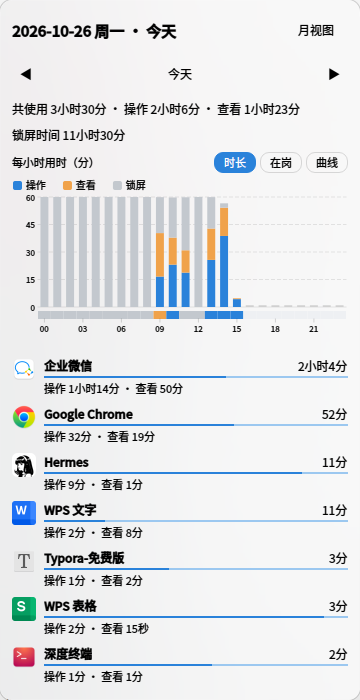

# 应用使用时间（app-usage-monitor）

> 统信 UOS / Deepin 深度任务栏（dde-dock）插件：自动记录每个应用的使用时长，并在托盘弹窗里用图表展示「一天 24 小时到底是怎么过的」。



## 下载

现成的安装包（amd64）：[app-usage-monitor_1.3.2_amd64.deb](releases/app-usage-monitor_1.2.0_amd64.deb)

```bash
sudo dpkg -i app-usage-monitor_1.3.2_amd64.deb
kill $(pgrep -x dde-dock)   # 重启任务栏让插件出现
```

## 特性

- **自动统计，无需手动操作**：任务栏后台每 3 秒采样一次当前焦点窗口，按应用累计使用时长，每 10 秒落盘一次。
- **操作 / 查看 两种口径**：有键鼠输入算「操作」，窗口开着但没输入算「查看」，可据此判断「人在不在电脑前」。
- **连续工作 30 分钟提醒休息**：操作和查看都算工作，累计满 30 分钟弹一次桌面气泡；锁屏满 3 分钟视为中断，连续时间清零重计。
- **锁屏时间单独记录**：通过 `com.deepin.SessionManager` 的 `Locked` 属性采集，锁屏期间不计入任何应用。
- **每小时用时图**：横轴 00–23 时，纵轴 0–60 分，蓝=操作、橙=查看、灰=锁屏堆叠显示。**没走完的小时只画实际分钟数，不会被归一化成 100%**。
- **三种视图**：`时长`（三段堆叠）/ `在岗`（只看操作+查看）/ `曲线`（三条折线对照）；鼠标悬停任意小时可看到精确分钟数与占比。
- **主导状态色带**：图下方 24 格色带，按每小时占主导的状态着色，一眼看出连续的工作时段与离开时段。
- **日 / 月两种视图**：日视图看当日明细与每小时构成；月视图看整月每日用时柱状图 + 该月应用总排行，右上角按钮一键互切。
- **中文应用名**：解析 `.desktop` 文件拿本地化名称与图标，而不是显示 `chrome`、`code` 这类进程名。
- **纯本地**：所有数据只写本机 SQLite，不联网、不上传。

## 界面说明

弹窗从上到下：

| 区域 | 内容 |
| --- | --- |
| 标题栏 | 日期 + 星期、`月视图` 切换 |
| 统计摘要 | 共使用 / 操作 / 查看 / 锁屏时间 |
| 每小时用时（分） | 24 根堆叠柱 + 主导状态色带，可切换 `时长` / `在岗` / `曲线` |
| 应用列表 | 按总时长排序，含时长条与「操作 / 查看」细分，滚轮可滚动 |

切到月视图后：

| 区域 | 内容 |
| --- | --- |
| 标题 | `2026年10月`，右上角按钮变成 `日视图` |
| 统计摘要 | 本月共使用 / 操作 / 查看 / 锁屏 |
| 每日用时 | 每天一根柱，横轴 1/5/10/15/20/25/月末，左上角标注当月单日最大值，今天那根颜色更深 |
| 应用排行 | 该月各应用累计时长，排序与日视图一致 |

从日视图进月视图会记住当前这一天，切回日视图直接回到那一天；如果中途翻到了别的月份，则回该月 1 号（在月视图点「今天」后切回就是今天）。

## 休息提醒

- **算作工作**：操作 + 查看，两者累加（只要前台有应用、不是锁屏，时间就在累计）。
- **满 N 分钟**（默认 30，可改）：弹一条桌面气泡「该休息一下了 / 已连续工作 30 分钟…」，并通过系统通知中心留档；点掉后从 0 重新计时，继续工作会再提醒一次。
- **锁屏满 3 分钟**：视为一次真正的中断，连续工作时长清零；不足 3 分钟（临时锁屏再解开）不打断连续计时，锁屏时长本身也不计入工作。
- **看当前状态**：鼠标悬停任务栏图标，提示会显示「已连续工作 N 分钟」。
- **关于**：弹窗标题行最右侧一个 14×14 的 ⓘ，点开显示版本、作者 shao-jun 和仓库地址。

### 改提醒间隔

两种方式，改完 **5 秒内生效，不用重启任务栏**：

1. **右键任务栏图标** → 勾选「连续工作 20 / 30 / 45 / 60 分钟提醒」，或「关闭休息提醒」。
2. **命令行**（装了 deb 就有）：

```bash
app-usage-monitor-rest 45      # 改成 45 分钟（5-240）
app-usage-monitor-rest off     # 关闭提醒
app-usage-monitor-rest         # 查看当前设置
```

设置存在 `~/.config/app-usage-monitor/settings.ini`：

```ini
[rest]
intervalMinutes=45    # 0 = 关闭
```

改间隔会从 0 重新计时，不会沿用旧的累计。

> 右键菜单需要 dde-dock 支持插件自定义菜单项（本机 5.10.x 可用）。如果你的任务栏右键没有这些项，用命令行的方式一样生效。

> 「查看」等于窗口有焦点但没输入，所以挂着窗口离开座位也会累计。要让自己准时休息，离开时请锁屏——锁屏 3 分钟后回来，计时就重新开始了。

## 导出数据

数据都在本机 SQLite 里，随时可以导成 CSV（UTF-8 带 BOM，Excel / WPS 直接打开）：

```bash
app-usage-monitor-export                    # 最近 14 天，导到 ~/下载/app-usage-export-<起>_<止>/
app-usage-monitor-export --days 30          # 最近 30 天
app-usage-monitor-export --from 2026-10-01 --to 2026-10-14
app-usage-monitor-export --out /tmp/dump    # 指定目录
```

导出的文件：

| 文件 | 内容 |
| --- | --- |
| `daily_usage.csv` | 每天每个应用的操作/查看/合计分钟数 |
| `hourly_usage.csv` | 每天每小时的操作/查看/锁屏分钟数 |
| `locks.csv` | 每天锁屏分钟数 |
| `switches.csv` | 每次切换的明细：时间、类型（window/chat）、前后应用与上下文、停留秒数 |
| `events.csv` | 手动事件明细：日期、起止时间、分钟数、名称 |
| `summary.csv` | 每天一行：切换次数、碎片切换、最长专注、事件次数与分钟数 |

数据只在本机，导出的 CSV 也只写到本机目录，不上传任何地方。

## 上下文切换

任务切换才是效率杀手，所以单独记一份「切换账」：

- **怎么算一次切换**：每秒看一眼前台窗口，换了应用或换了窗口就算一次；上一个窗口停留不到 10 秒的算「碎片切换」。
- **企业微信里换会话**：客户端窗口标题永远是「企业微信」，所以用截图 + OCR 认聊天标题（私聊是真名，群聊是群名）。需要装 `tesseract-ocr` 和 `tesseract-ocr-chi-sim`，没装就只记窗口级切换；不想用可以在 `settings.ini` 里写 `[switch] ocr=0`。
- **手动事件**：点「＋ 添加事件」，记下「出去开会」「被人叫走」「接电话」「休息」这类外部中断，可以按 时:分 和时长填，也能删除。

弹窗标题行点「切换」看当天统计：

| 区域 | 内容 |
| --- | --- |
| 摘要 | 共 N 次切换 · 平均几分钟一次 · 高峰几点几次 · 碎片切换次数 |
| 柱状图 | 每小时切换次数，峰值那根颜色更深 |
| 高频跳转 | 最常出现的应用/窗口跳转 Top 5（A → B） |
| 企业微信会话 | 切换最多的会话 Top 5 |
| 今日事件 | 事件时间段与名称，可删；下面就是「＋ 添加事件」 |

## 采集口径

采样周期 3 秒，每次读取焦点窗口与系统空闲时长，把两个采样点之间的时间记到「上一次"的窗口」上：

| 场景 | 判定 | 计入 |
| --- | --- | --- |
| 会话已锁屏 | `Locked == true` | 锁屏时间（不记给任何应用） |
| 空闲时长增量 ≥ 采样间隔的 3/5 | 无输入，只是开着窗口 | 查看 |
| 其余情况 | 有键鼠输入 | 操作 |
| 无焦点窗口（桌面） | `_NET_ACTIVE_WINDOW` 为空 | 不计时 |

> ⚠️ 「查看」的判定是「窗口有焦点但没有输入」，所以**开着窗口去吃饭**也会被算成查看时间，而不是离开。这是刻意的取舍：想统计「离开」请直接锁屏。

单次采样的时间增量上限为 4 个采样周期（12 秒），避免休眠唤醒后把大段时间错误地记到某个应用上。

## 数据存储

数据库：`~/.local/share/app-usage-monitor/usage.db`（SQLite，首次运行时自动创建）

```sql
-- 应用 × 天
CREATE TABLE usage (
    date TEXT NOT NULL,
    app TEXT NOT NULL,            -- 稳定标识（WM_CLASS / 进程名，小写）
    display_name TEXT,            -- 本地化展示名
    icon TEXT,
    active_ms INTEGER,            -- 操作毫秒
    viewing_ms INTEGER,           -- 查看毫秒
    PRIMARY KEY (date, app)
);

-- 天 × 锁屏
CREATE TABLE locks (
    date TEXT PRIMARY KEY,
    lock_ms INTEGER
);

-- 天 × 小时，图表数据源
CREATE TABLE hourly_usage (
    date TEXT NOT NULL,
    hour INTEGER NOT NULL,        -- 0-23
    active_ms INTEGER,
    viewing_ms INTEGER,
    lock_ms INTEGER,
    PRIMARY KEY (date, hour)
);
```

## 依赖

- Qt 5.11+（Widgets、Sql、DBus）
- `dde-dock` 开发包（`dde-dock.pc`）
- X11 开发包（`x11.pc`）
- 运行时：`xprintidle`（用于读取空闲时长）

Debian / UOS 系安装：

```bash
sudo apt install build-essential cmake qtbase5-dev libqt5sql5-sqlite \
                 libdde-dock-dev libx11-dev x11-utils
```

## 构建

```bash
cmake -S . -B build -DCMAKE_BUILD_TYPE=Release
cmake --build build -j"$(nproc)"
# 产物：build/out/libapp-usage-monitor.so
```

## 安装

```bash
sudo ./install.sh
```

脚本会完成构建 → 把 `.so` 装到 `/usr/lib/dde-dock/plugins/` → 重启 `dde-dock`。

手动安装：

```bash
sudo install -m 755 build/out/libapp-usage-monitor.so /usr/lib/dde-dock/plugins/
kill "$(pgrep -x dde-dock)"   # 由 startdde 自动拉起
```

装好后托盘会出现一个三根柱子的图标，点击即弹窗。

## 打包成 deb（发给别人试用）

```bash
./packaging/build-deb.sh           # 默认版本 1.0.0，产物在 dist/
./packaging/build-deb.sh 1.1.0     # 指定版本号
```

对方收到后：

```bash
sudo dpkg -i app-usage-monitor_1.3.2_amd64.deb
# 装完重启一次任务栏，图标才会出现
kill $(pgrep -x dde-dock)
```

卸载：

```bash
sudo dpkg -r app-usage-monitor
```

包只包含插件本体和文档，不会自动重启任务栏（避免打断用户），也不会删你的历史数据。
仅提供构建机对应的架构（本项目在 amd64 上构建，arm64 需自行重打）。

## 卸载

```bash
sudo rm /usr/lib/dde-dock/plugins/libapp-usage-monitor.so
kill "$(pgrep -x dde-dock)"
rm -rf ~/.local/share/app-usage-monitor   # 连同历史数据一起删除（可选）
```

## 目录结构

```
.
├── src/
│   ├── appusagemonitorplugin.*   # dde-dock 插件入口、托盘图标、弹窗装配
│   ├── usagetracker.*            # 3 秒采样、操作/查看/锁屏判定、攒批落盘
│   ├── x11windowinfo.*           # X11 读取焦点窗口与所属进程
│   ├── idledetector.*            # 调用 xprintidle 读空闲时长
│   ├── appregistry.*             # .desktop 解析：本地化名称与图标
│   ├── usagestorage.*            # SQLite 读写
│   ├── usagepopupwidget.*        # 弹窗 UI + 自绘小时图表控件 + 关于对话框
│   ├── usagechart.*              # 小时分钟数 / 占比 / 时段文字等纯计算
│   ├── restreminder.*            # 连续工作计时与 30 分钟提醒判定（纯计算，可单测）
│   ├── restnotifier.*            # 走 org.freedesktop.Notifications 发气泡
│   ├── contextswitch.*           # 每秒采样前台窗口，记录上下文切换
│   ├── chattitleocr.*            # 截图 + tesseract 识别企业微信会话名
│   ├── switchstats.*             # 切换统计（次数/间隔/高峰/高频跳转，纯计算可单测）
│   ├── addeventdialog.*          # 添加事件对话框
├── tools/
│   └── export.cpp                # app-usage-monitor-export：导出 CSV
│   └── usageentry.h              # 数据结构
├── packaging/
│   ├── build-deb.sh                    # 打 deb
│   └── app-usage-monitor-rest          # 改提醒间隔的命令行工具
├── docs/screenshot.png
├── CMakeLists.txt
└── install.sh
```

## 已知限制

- 只支持 X11 会话；Wayland 下 `_NET_ACTIVE_WINDOW` 取不到，需要另走合成器协议。
- 依赖 `xprintidle`，没装时空闲时长恒为 0，所有时间都会被记成「操作」。
- 应用名与图标来自首次识别时的缓存；换语言或换主题后旧记录不会自动刷新。
- 修改空闲判定阈值只影响之后的数据，历史记录不会重算。

## 许可证

[MIT](LICENSE)
